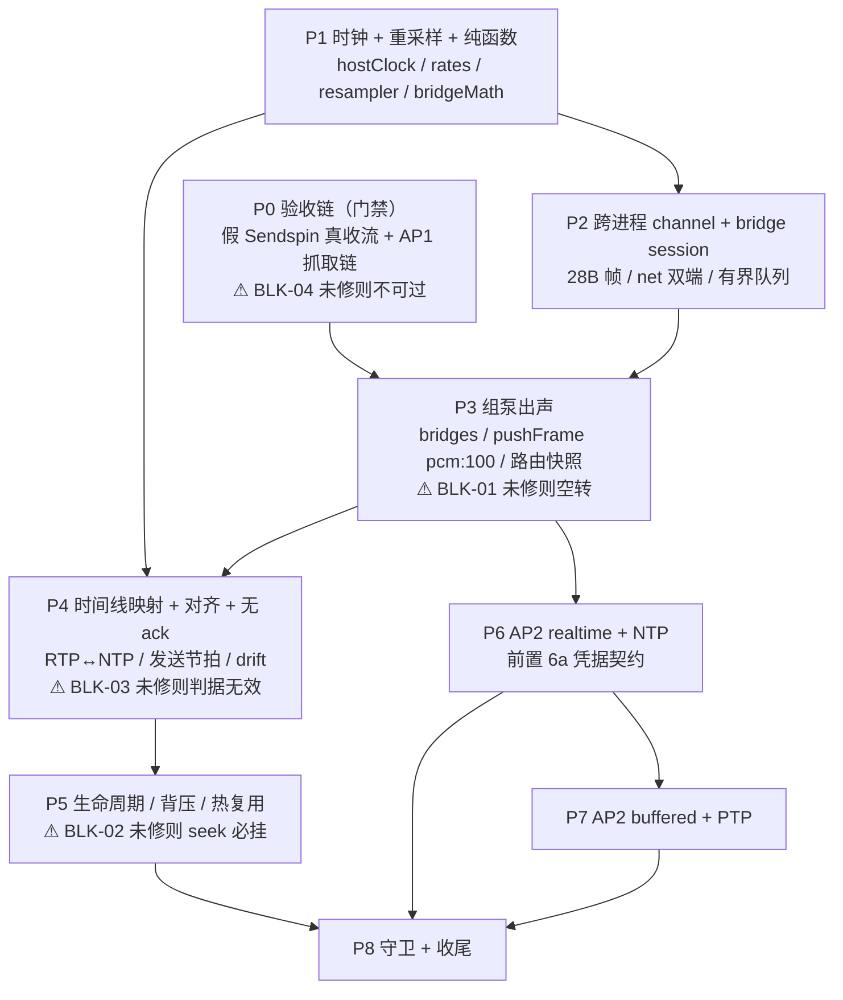

# AirPlay 1/2 × Sendspin 桥接方案 · 终审（Red Team）报告

> 审查对象：`AirPlay1-2与Sendspin桥接-最终实施方案.md`（734 行，开发执行版）与 `AirPlay1-2与Sendspin桥接落地方案.md`（855 行，调研论证版）
> 审查基线：MusicFlow `8d7a0ff`（实测 `git log -1` 为 **2026-10-24**，文档写 2026-10-25，见 NIT-05）
> 取证环境：230 `/workspace/MusicFlow/backend/src`、`backend/tests`，全部只读（grep/sed/wc/sha256sum/strings/ss/lsmod）
> 审查日期：2026-10-25

---

## 0. 审查结论

**一句话结论**：架构骨架（并行 `bridges`、不归零 `latencyFrames`、`startNtp = ntpFromHostUs(A−L)`、单一 host 时钟、net 二进制通路、hardCap 断连）经逐行取证**全部成立且数学自洽**，可以照着实现；但**验收链本身是断的**（4 条 Blocker 有 3 条落在"能不能证伪"上），且 seek 与"最后一个 Sendspin 成员被摘除"这两个高频生命周期在文档描述的机制与源码实际行为**不一致**——照文档写会在两处必然出错。

**是否可进入开发**：**有条件可进入**。Phase 1（时钟/重采样/纯函数）可立即开工，无 Blocker 阻挡；**Phase 3（组泵出声）与 Phase 4（时间线映射）开工前必须先修 BLK-01/BLK-02/BLK-03/BLK-04**，否则 Phase 4 的退出判据不可执行、Phase 5 的 seek 用例必然失败。

| 级别 | 数量 | 说明 |
|---|---|---|
| Blocker | **4** | 不修则必然返工或验收无法判定 |
| Major | **10** | 会造成决策失效 / 生命周期漏场景 / 观测不可执行 |
| Minor | **11** | 数字、路径、定义不精确，会在实现时产生歧义 |
| Nit | **5** | 表述/一致性/基线元数据 |

已抽查事实 **34 条**（§2），其中 ✅ 一致 26 条、❌ 不一致 4 条、⚠️ 无法判定 4 条。

---

## 1. 问题清单

> 排序：Blocker → Major → Minor → Nit；同类内按实施方案章节顺序。

### 1.1 Blocker

| 编号 | 位置 | 问题 | 证据 | 建议修法 |
|---|---|---|---|---|
| **BLK-01** | 实施方案 §2.1、§6.2（"`pushFrame` 在编码组循环里额外把 `pcm:100` 的字节投给每个 bridge"）；§5.2 表格"摘除最后一个 Sendspin ⇒ 泵继续跑" | `pushFrame` 的编码分组**只遍历 `this.members`**。若组内没有"codec=pcm 且 gain=100"的真实成员，`pcm:100` 组根本不存在 ⇒ 桥拿不到一个字节；若组内最后一个真实成员被摘除，`groups` 为空 ⇒ 编码循环体一次都不执行，`deliveredPeak` 不推进、返回 0。落地方案 3.1-(1c) 有一句"只有 bridge 时 `pcm:100` 组仍能让 `deliveredPeak` 正常推进"，但**开发执行版里没有这条强制指令**。 | `server.ts:1129-1140`（`groups` 仅由 `this.members` 构建）、`:1205`（`sum > meterSamples` 计量）、`:1237`（`return peak - before`）；`streamEngine.ts:225` `STALL_GRACE_US = 500_000`、`:929-936`（零产出 500ms 后降级推进，5s 后 `error: 编码器持续零产出…放弃本曲提前切歌`，`maxSilentDegradeUs()` 默认 5000ms） | ① 明确要求：`pushFrame` 入口处**先补一个虚拟 `pcm:100` 组**（`if (this.bridges.size > 0 && !groups.has("pcm:100")) groups.set("pcm:100", {codec:"pcm", gain:100, members: []})`），使编码/ring/`deliveredPeak` 与成员是否存在**解耦**；② 把落地方案那句判定搬进实施方案 §2.1 并写进守卫；③ 单测：`members=∅ + 1 bridge` 时 `pushFrame` 返回值 > 0 且 bridge 收到字节 |
| **BLK-02** | 实施方案 §4.3「`streamEngine.ts` 在 `reseed` 分支（`this.timelineReseed !== consumedReseed`）调用 `group.bridgeTimelineReset?.("seek")`」；§5.4「`seek`：只发 `spinOp`；`timelineReseed` 触发 bridge 新 generation」 | **机制写错了两处**：① `timelineReseed` 全仓**只有 `rehost()` 一处自增**（泵移交），`seek()` 只写 `positionMs/reportedFloorMs/pendingSeekMs`，**从不碰 timelineReseed**；② seek 的真实实现不是"只发 spinOp"，而是 `seekCore` → `pump.stop()` + `playGroupCore(...)` 走完整重建（新 ffmpeg、新 pushLoop、`timelineBaseUs` 归零、`g.close()` 清空编码器与 late-join ring），并且这条路径**不传 bridge 参数**。按文档实现，seek 后桥接既不换 generation 也不重新注册。 | `streamEngine.ts:1213-1234`（seek 全文）、`:1291`（唯一 `timelineReseed++`，位于 `rehost()`）、`:813`（`firstFrame \|\| timelineReseed !== consumedReseed`）；`playerCore.ts:649-712`（`seekCore`）、`:706`（`playGroupCore(srv, clientId, memberIds, item, onFailed, clampedMs)` — 无 bridge）、`:356-362`（`playGroupCore` 签名无 bridge）、`:380-382`（`pump.stop()` / `g.close()`）；`server.ts:1375-1382`（`g.close()` 清 `encoders` + `recentByGroup`）；`childMain.ts:164-173`（`case "groupPlay"` 不消费 `p.bridge`） | ① 把 generation 自增**绑定到真实边界**：`clearPlayback`（track）与 `finishPlayback`（stop），二者在 `playGroupCore` 里必发其一（`canKeepStream()` 三分支，`playerCore.ts:387-392`），这才是 seek 时确实会经过的路径；② 删除 §4.3/§5.4 中关于 `timelineReseed` 的说法；③ 明确 `bridges` 的生命周期**独立于 pump**（`pump.stop()`/`g.close()` 都不清 bridges，只有 `bridgeStop`/`stopGroupCore` 清）；④ 补一条 Phase 5 验收：seek 后 airplay 侧必须打出**新 generation + 新 `scheduledAnchorUs`**，且旧 generation 帧计数为 0 |
| **BLK-03** | 实施方案 §8 Phase 0 出口 4（"测试源文件（1kHz 正弦，双声道，120s）"）+ §10.2（互相关判据 `\|delta_ms\| ≤ 20`） | **用 1kHz 正弦做互相关测 Δ 在数学上不成立**：1kHz 的周期是 1ms，两份正弦的归一化互相关在 lag 上以 1ms 为周期重复，峰位只能确定到 1ms 的整数倍集合中的一个（且极易锁在错误的倍数上），`quality` 又几乎恒为 1（全都被判"可信"）。20ms 的判据等于用一个只能分辨模 1ms 的尺子去量 20ms——**这正是文档自己反复强调要避免的"假证据"**。 | 实施方案 §8 Phase 0 出口 4；§10.2 脚本（`rate=44100`，`w=rate*10`，`argmax` 取峰）；正弦自相关周期 = 1/1000 s = 1ms | Δ 测量必须换**宽带源**：白噪 / MLS / 线性 chirp / 有节奏的真实音乐；1kHz 正弦**只保留给** §10.3 基频与抗混叠用例。或折中：正弦上每 100ms 打一个宽带脉冲标记，用标记互相关。脚本加一条硬断言：`quality` 在全 1ms 倍数上不得同时 >0.99（否则判"源不适用"） |
| **BLK-04** | 实施方案 §10.2（读 `/root/ap1_cap_44.pcm`）与 §11 验收总表 #6（Δ≤20ms） | **AP1 侧"设备实际播放的 PCM"从哪来，全文没有定义**：§10.2 直接读 `/root/ap1_cap_44.pcm`，而 230 上该文件**不存在**；落地方案 Phase 0 定义的 `MUSICFLOW_AIRPLAY_PCM_OUT=<path>` 是"**发送端**写出的 PCM 同步落盘"，测到的是"进程间管道 + 重采样链"，**与设备什么时候真的出声无关**——用它算出的 Δ 恒≈0，是最危险的那种"必过"判据。 | 230 实测：`ls /root/*.pcm` → `ap1a_out.pcm / ap1a.pcm / ap1b_out.pcm / ap1b.pcm / ap1_capture.pcm / test.pcm`（**无 `ap1_cap_44.pcm`**）；`lsmod \| grep -c snd_aloop` = 4（ALSA loopback 已加载，具备抓取条件）；落地方案 §Phase 0 "落盘开关 `MUSICFLOW_AIRPLAY_PCM_OUT=<path>`：发送端写出的 PCM 同步落盘（用于互相关）" | ① 定义 AP1 接收端抓取链并写进 §10：`shairport-sync` 输出到 `hw:Loopback,0` → `arecord -D hw:Loopback,1 -f S16_LE -r 44100 -c 2 -d <N> /root/ap1_cap_44.pcm`；或让 AP1 床改用可控的 `/tmp/ap2recv/ap2/airplay1.py`（1484 行，实测存在）自己写 PCM；② `MUSICFLOW_AIRPLAY_PCM_OUT` 的用途改为"排查管道/重采样"，**禁止**用于 Δ 判据；③ Phase 0 出口新增一条可机械验证的：`arecord 5s → peak>1000` |

### 1.2 Major

| 编号 | 位置 | 问题 | 证据 | 建议修法 |
|---|---|---|---|---|
| **MAJ-01** | 实施方案 §2.1「bridge 的 lead 单独并入 `commonSendAheadUs()`」、§3.4、§6.2 | 把这个 4500ms 并进 `commonSendAheadUs()` 的**副作用未评估**，且与 D4「三层分离」自相矛盾。<br>① `commonSendAheadUs()` 有 **3 个消费者**：pushLoop 时间线锚点、`seedLateJoin` 晚加入目标、`playerCore` 播报锚点；<br>② **音频帧头里根本不含 `send_ahead`**（9B 头 = type+ts），真实设备用的是**它自己的**默认 800ms；所以并进去以后，全组时间戳整体被推到 4.5s，而设备仍按 800ms 判断，`delta = (ts − 自己的 send_ahead) − now` 恒等于 **+3.7s**；<br>③ `computeCommonSendAhead` 用 `max(minBufferMs, requiredLeadTimeMs)` 把"启动 lead"和"持续 min buffer"**合并成一个数**，一旦并入 4500，"热启 2500 / 持续 1000"永远不可能出现（D4 失效）；<br>④ §3.4 同时给了 `bridgeStartLeadUs()` 作第二条入口 ⇒ 同一个数字两个来源。 | `server.ts:815-816`（`computeCommonSendAhead([...this.members].map(sendAheadInputOf))`）；`server.ts:2378-2385`（注释原文"帧头 = 9B(1B type + 8B 微秒时间戳)，**不含 send_ahead**"）；`server.ts:1271-1272`（`seedLateJoin` 注释"设备用的是它自己的(未协商时默认 800ms)"）；`group.ts:76-92`（`lead = Math.max(minBuffer, requiredLead)`）；`streamEngine.ts:835`、`playerCore.ts:875`（另外两个消费者） | 二选一并在文档写死：**推荐**只在 `streamEngine` 的 `anchorLead` 用 `bridgeStartLeadUs()`，`commonSendAheadUs()` **不动**（真实设备行为零变化，D4 三层保持）；若坚持并入，必须把 `requiredLeadTimeMs` 与 `minBufferMs` 拆成 `startLeadUs()` / `ongoingSendAheadUs()` 两个函数，并接受"全组起播 4.5s + 设备侧 delta 常数偏移"这一新事实，同时改 D4。加一条回归：纯 sendspin 组 + 一台 bridge 时，真实设备日志不得出现常数 +3.7s 偏移 |
| **MAJ-02** | 落地方案 §3.3「三条候选通路（**已拍板，D2**）」、§3.1-(1c)「见 **D4** 修正」（指音量） | **决策编号跨文档指代不同**：落地方案的 "D2" 指"跨进程通路"，而实施方案 D2 = 时钟与时间戳、通路是 **D3**；落地方案的 "D4 修正" 指音量，而实施方案 D4 = 延迟分层、音量是 **D5**。两份文档同时在线时，任何人引用 D2/D4 都会指向错的决策。 | 落地方案 `:298`、`:221`；实施方案 §1 决策表 `:46`（D2）、`:47`（D3）、`:48`（D4）、`:49`（D5） | 落地方案正文改为显式引用"实施方案 §1 · D3 / D5"，或在落地方案 §0 增加一张 D 编号映射表；并规定"决策编号只在实施方案里定义" |
| **MAJ-03** | 实施方案 §8（Phase 0–8）vs 落地方案 §4（Phase 0/1/2a/2b/3/3.5/4/5a/5b/6） | **两套阶段编号并存且验收门槛错位**：落地方案 P2a 的出口就要求"两边都出声"，实施方案要到 **P3** 才做组泵出声；落地方案 P2b 就要求 Δ≤20ms，实施方案是 **P4**；落地方案 P3"对齐与音量"≈实施方案 P4 的一部分。开发者按哪一份排期都会对不上。 | 实施方案 `:470/492/503/510/521/532/543/551/559`；落地方案 `:337/347/356/373/381/387/391/395/407` | 落地方案 §4 顶部加"阶段映射表"并声明"阶段编号与退出判据以《最终实施方案》为唯一口径"；两处对同一阶段的出口条件必须逐字一致 |
| **MAJ-04** | 落地方案 §5.2 用例 4/6、§5.3 运行命令 | 验收矩阵**仍以 AP2 为桥接对象**（"A（假 Sendspin）+ B（AP2）入同一组"、`ap2bed/ap2-1/out.pcm`），与实施方案"AP1 先行、AP2 后置到 P6"的顺序冲突；且脚本 `/root/cc_align.py` 在 230 **不存在**（落地方案 §Phase6 自述"应作为独立脚本进 CI"，实际未落盘）。 | 落地方案 `:569/571/659`；230 实测 `ls /root/cc_align.py` → `No such file or directory` | 用例 4/6 改为 AP1 侧；脚本收进 `backend/scripts/`（带 `_selftest()` 强制前置）并注册 CI；落地方案标注"AP2 用例在 P6 之后启用" |
| **MAJ-05** | 实施方案 §4.1（socket 路径） | 路径长度未校验：`os.tmpdir()/mf-apbridge-<deviceId>-<sessionToken>.sock`。Linux `sockaddr_un.sun_path` 上限 **108 字节**，超过即 `bind(): ENAMETOOLONG`。若 `deviceId` 是 36 字符 UUID、`sessionToken` 用 64 hex ⇒ 27+36+1+64+5 ≈ 133 字节，**必然失败**，且失败点是"每台桥都建不起来"这种全量故障。 | 实施方案 §4.1 `:225`；路径组成部分由 `:240`（generation 32 位）与 §5.5 `token` 设计推定 | 规定 `<tmpdir>/mfab/<11 字符 base36 hash>.sock`（token 只进 `CONFIG` payload，不进文件名）；`bridgePrepare` 前做 `Buffer.byteLength < 100` 断言；单测覆盖长 UUID deviceId |
| **MAJ-06** | 实施方案 §5.5（会话所有权）、§9 守卫矩阵（`check-airplay-dlna-mutex`） | **桥会话与现有"同 host 全停"互斥逻辑的关系没写**。`stopAirPlaySessionsForHost(host)` 会遍历该 host 的**全部** active session 并 stop，它被 DLNA 双协议互斥调用；桥会话若登记进同一个 `sessionRuntime` 会话表，DLNA 一 cast 就把桥会话杀掉（反向亦然）。§9 只说"bridge 起播同样纳入"，没有说明桥会话在互斥里算哪一类。 | `control.ts:302-329`（`stopAirPlaySessionsForHost`）、`:327-329`（`stopAirPlaySession`）；`control.ts:946-948`（`stopAirPlay`）；实施方案 §5.5 `:342-353` | 在 §5.5 里明确：`SessionOwner.kind === "bridge"` 的会话**不得**被 `stopAirPlaySessionsForHost` / DLNA 互斥停掉（只按 owner token 停），也不得触发 DLNA 侧 stop；守卫加一条断言 |
| **MAJ-07** | 实施方案 §4.1（"任何一侧失败：该设备不加入 bridge 路由，记录 `bridgeUnavailable`"）+ D6（"流内不切路由"） | **单侧失败的降级路径缺失**：prepare 失败发生在流已经开始之后，而 D6 规定流内不切路由 ⇒ 这台 AirPlay 设备整首**既不 bridge 也不 cast**，用户在组里看到它、它不出声，且没有任何用户可见提示。 | 实施方案 `:230`、`:50`；`group/protocolPlayer.ts:105-140`（fanOut 现状：逐设备 cast） | 定义降级：prepare 失败 ⇒ 该设备本流回落 solo cast（与 bridge 互斥由 owner token 保证），并在状态里标 `degraded`；或整组退回 legacy-cast（需重启 pump，需评估代价）。无论选哪条，都必须给"用户能看到"的判据 |
| **MAJ-08** | 实施方案 §10（用例 6 "stats 稳定"）、落地方案 Phase 0（"每 2s 一行 `w/m/clock/delta`"） | **`delta` 没有定义基准**：是成员 vs 组时间线？成员 vs 成员？还是成员 vs 墙钟？没有定义就无法写脚本断言"稳定"，用例 4/6 事实上不可执行。 | 落地方案 `:340`；实施方案 §11 #6 `:701` | 显式定义：`delta_us = 成员上报的 playhead_us − (group.timelineBaseUs − 该成员缓冲深度_us)`；同时输出 `delta_p95_us`、窗口长度、样本数；验收写成"10s 窗口内 `p95(|delta|) ≤ 20ms` 且无单调漂移（斜率 ≤ 1ms/10s）" |
| **MAJ-09** | 实施方案 §3.3（只定义 `startTs / startNtp / headTs` 三个锚点） | 漏了 **`baseTs`**：`positionSec = ts2ms((headTs − baseTs) >>> 0)` 用的是 `baseTs`，RECORD 时 `baseTs = headTs`（同一个数）。桥接一旦把 `startTs` 改成 `rtp(A) = B` 而 `baseTs` 仍是 RECORD 的值，`positionSec` 立刻变成垃圾，`getAirPlayStatus`/进度上报全错。落地方案 3.2-2 提到"`baseTs`（RECORD 时固定）"但没给桥接的处置。 | `raop.ts:272-284`（`headTs/startTs/startNtp/baseTs` 声明）、`:598-603`（RECORD 初始化）、`:694-695`（`headTs` 推进 + `positionSec` 用 `baseTs`）、`:803`、`:846/869`（`seekStartTs(baseTs, …)`） | §3.3 改为一次写**四个**字段：`{baseTs=B, startTs=B, headTs=B, startNtp=ntpFromHostUs(A−L)}`；并规定桥接路径**不得**调用 `raop.seek()`（它会把 `startTs` 拉回 `baseTs+seekSec*rate` 而 `startNtp` 不动 ⇒ 映射崩） |
| **MAJ-10** | 实施方案 §3.1（`ntpNow()` 改 `ntpFromHostUs(nowUs())`） | **时钟纪元从"进程运行时长"变成"机器开机时长"，`ntp2ts()` 的结果会越过 2^32**：`ntp2ts ≈ sec × rate`，44.1k 下 `2^32/44100 = 97391s ≈ 27.05h`，48k 下 24.9h。越过之后 `baseTs/startTs` 保留 13 位十进制值，而 `headTs` 每次都被 `>>> 0` 截到 32 位。**现有代码靠"模 2^32 差值"侥幸自洽**（`(headTs−startTs)>>>0` 恰好还原真实增量，本报告已验算），但由此多出两个隐式不变量：(a) RTSP `RTP-Info: rtptime=<13 位>` 会把 >2^32 的十进制发给接收端（依赖对方按 uint32 截断解析）；(b) 桥接新写的 `rtp(t)=B+round(...)` **必须**落在同一模运算域，否则立刻错。文档只写了"B 是 32 位回绕安全"，没有任何测试兜住这条。 | `raop.ts:88-94`（`ts2ntp`/`ntp2ts`）、`:599`（唯一 `ntp2ts` 调用）、`:601-603`、`:694`（`(headTs + CHUNK_LEN) >>> 0`）、`:731`（`(headTs − startTs) >>> 0`）、`:604`/`:858`（RTP-Info 发 `headTs`/`startTs` 十进制）；230 `cat /proc/uptime` = 22953s（6.4h，当前未触发，但 27h 是常态） | ① `RECORD` 后立刻把 `baseTs/startTs/headTs` 统一 `>>> 0`（一个 `& 0xffffffff` 就能让"隐式自洽"变成"显式不变"）；② 桥接的 `B` 明确取 `B = (RECORD 的 headTs) >>> 0`；③ 补一条单测：把 `setNowUsOverride` 设到 `sec = 100000`（>27h）跑完整 RECORD+sendChunk+sendSync，断言 `positionSec` 与 `elapsedTs` 正确 |

### 1.3 Minor

| 编号 | 位置 | 问题 | 证据 | 建议修法 |
|---|---|---|---|---|
| **MIN-01** | 实施方案 §4.5「重采样器群延迟 16 输入帧 ≈0.33ms，直接计入 A 的补偿（`A += 0.33ms`）」 | 数字与符号都不严谨：① "每相 32 抽头" × 160 相 ⇒ 原型 5120 抽头，群延迟 = 2560 上采样样本 = **17.4 输入帧 ≈ 0.363ms**（不是 16 帧 0.33ms）；② 0.363ms 与 0.33ms 差 10%，虽小但它是**常数系统偏差**，与另一侧（若还有别的常数偏差）叠加后会吃掉预算；③ "A += 0.33ms" 的**方向依赖 A 的定义**（若 A 指写进 `startNtp` 的映射锚点则正确；若 A 指"内容首样本应可听时刻"则符号反了），文档未定义清楚，实现时极易写反。 | 实施方案 `:288`；落地方案 `:349`（"每相 32 抽头…群延迟 N/2=16 输入帧≈0.33ms"）；算术：5120/2=2560 上采样样本，2560/147=17.41 输入帧，17.41/48000=0.3627ms | 把群延迟写成 `(tapsPerPhase × phases / 2) / L / 48000` 的表达式并在单测里断言（0.3627ms ± 1µs）；明确"A = 写进 `startNtp` 的映射锚点"，并加一条单测：脉冲经重采样后落在 `A + 0.3627ms` 的位置（而不是 0.33ms） |
| **MIN-02** | 落地方案 附录 C #1 依据列：`sendspin/time.ts` | **该文件不存在**。`nowUs` 的真实位置是 `services/sendspin/clock.ts:21-22`（实施方案 §3.1 写对了，落地方案写错）。这是"证据纪律"条款下的自伤。 | `services/sendspin/time.ts` → `没有那个文件或目录`；`services/sendspin/clock.ts:13/17/21-22` | 落地方案 附录 C #1 改 `sendspin/clock.ts:21-22`；顺带核对附录 B/C 里所有"文件:行"是否随基线漂移 |
| **MIN-03** | 实施方案 §3.3 与 §0.1 表格："`raop.ts` 的 `latencyFrames = Math.max(audioLatency, sampleRate)`（`:289`/`:615`）" | `:289` 不是这个公式，是**初始化** `private latencyFrames = SAMPLE_RATE;`；`Math.max` 只在 `:615`。把两处并列成同一公式，会让人以为 `:289` 也做了 max（进而以为"初始就有 audioLatency"）。 | `raop.ts:289`（`private latencyFrames = SAMPLE_RATE;`）、`:613-616`（`Math.max(audioLatency, this.opts.sampleRate)`） | 改写为"`:289` 初值 = `SAMPLE_RATE`（1000ms）；`:615` RECORD 返回 `Audio-Latency` 时取 `max`" |
| **MIN-04** | 实施方案 §7.1 `BridgeSocket.protocol: "raop" \| "ap2"`；落地方案 Phase 5a「`--protocol airplay2-compat` 也要覆盖」 | 接口**不闭合**：`airplay2-compat`（auth-setup + RAOP，见落地方案 §2.3）既不是纯 RAOP 也不是 AP2 buffered/realtime，但协议枚举里没有这一档，桥接侧无法据此选速率/时钟/加密路径。 | 实施方案 `:404`；落地方案 `:400`、`:106` | 枚举扩为 `"raop" \| "ap2-realtime" \| "ap2-buffered" \| "ap2-compat"`，并给每个值映射 `{rate, clock, encryption}` |
| **MIN-05** | 实施方案 §4.4「airplay 侧另有 8s PCM 队列」 | 未说明 8s 按哪个速率折算：48k 下 8s = 1.536MB，44.1k 下 8s = 1.41MB。发送侧 hardCap 用 48k 口径（1.5MB），接收侧若用 44.1k 口径，两边阈值不对齐（会造成"发送侧还没到 hardCap、接收侧已经 overflow 断连"）。 | 算术：48000×2×2×8 = 1,536,000B；44100×2×2×8 = 1,411,200B | 明确规定接收侧队列也按**输入速率 48k** 计量（即重采样前长度），与发送侧同口径；或两边都用"秒"而不是"字节"做阈值 |
| **MIN-06** | 实施方案 §3.4「必须同时修改 `streamEngine.pushLoop` 的预填充钳制」 | 只提了 `:846` 一处是对的（`:1028`/`:1082` 经核验**不是** lead 钳制：`:1028` 是 prefill 使能门 `targetUs > ANCHOR_SAFE_LEAD_US`，`:1082` 是曲末排空量）；但 `:1082` 的公式 `(cursorUs − nowUs() − ANCHOR_SAFE_LEAD_US)/1000` 在 bridge lead = 4500ms 时会把**曲末排空等待从 ~3s 拉长到 ~3.7s+**（即切歌静默变长），文档未提。 | `streamEngine.ts:1028`、`:1082-1085`；`:845-848` | 在 §3.4 补一句：bridge 路由下曲末排空按 `bridgeStartLeadUs` 而非 800ms 计算，或显式接受并记录这个切歌间隙变化 |
| **MIN-07** | 落地方案 §5.2 用例 6/8/9/10 | 判据**不可证伪**（无量化门限）：#8"无断音"只给了"reanchor 计数不抬升"（尚可）；#9"恢复后 Δ 收敛"无数值；#4"`delta` 稳定"无数值（见 MAJ-08）；#10"仍锚定（不停播）"可判但缺"如何确认它真的在锚定而不是在放旧缓冲"。 | 落地方案 `:571-575` | 每条补阈值：收敛 = "10s 内 `|Δ|` 单调降到 ≤20ms"；稳定 = "`p95(|delta|) ≤ 20ms`"；#10 = "锚点日志在 3 个 sync 周期内持续输出且 `late=0`" |
| **MIN-08** | 实施方案 §11 #6、§10.2 阈值 20ms | 20ms 相对采样粒度（44.1k 22.7µs / 48k 20.8µs）**不是过松而是过宽**——它比样本粒度大 3 个数量级，因此"技术上不难通过"；但对"多房间同步"这一目标偏松（双扬声器梳状滤波在 1~2ms 内开始可闻）。且**跨速率比较会污染 Δ**：若用 `ffmpeg -af aresample=44100:filter_size=64` 先统一速率（§10.2 前置命令），该重采样器自身有群延迟，会直接加进 Δ。 | 实施方案 `:637-641`（aresample 前置）、`:527` 判据 | 分档：同协议/同采样率 ≤5ms；跨协议 ≤20ms（作为**上限**而非目标）。Δ 测量优先用**同一份 44.1k 源**分别投两侧，避免重采样进入比较链；必须重采样时，先用脉冲测出该滤镜的群延迟并在 Δ 里扣除 |
| **MIN-09** | 实施方案 §5.5「`stopSession` 必须带 token；token 不匹配不得关闭别人的会话」 | 接口改动**波及面未评估**：现有 `stopSession(deviceId)` 无 token 参数，`childMain.ts` 的 `stopSession` / `stopSession` 路由 / `stopAirPlay(deviceId)` / `stopAirPlaySessionsForHost` 都直接按 deviceId 停。改签名要动 `control.ts:302/327/946/1093`、`ipcProtocol`、airplay 子进程 dispatch 与若干测试。文档只给了"必须"没给"谁改、改哪些调用点"。 | `airplay/childMain.ts:66-72`（`stopSession`）、`control.ts:327/946`、`:1065`（`setAirPlayVolume(deviceId, volume)`）、`:1093`（`setAirPlayMuted(deviceId, muted)`） | §6.2 增加一行"`airplay/control.ts` + `airplay/childMain.ts` + `airplay/ipcProtocol.ts` 的 stop 系调用点全部加可选 `token`，缺省 = 旧语义"，并列出受影响的调用点清单 |
| **MIN-10** | 实施方案 Phase 6（"HAP pair-setup/verify，凭据落 `hap_credentials`…需定义消费契约"）vs Phase 6 出口（"与 cliairplay 对同一 AP2 接收端 A/B 通过"） | **矛盾**：凭据消费契约在 Phase 6 里是"待定义"，但 Phase 6 的出口要求配对全跑通——不定义写入时机/失效清理，配对"成功"只在内存里，重启即失，A/B 无法复现。 | 实施方案 `:543-549`；落地方案 附录 C #30 `:850`（"`hap_credentials` 的写入/验证/失效契约 🔴 未定义"，实测全仓仅 `db/index.ts:469/752-761`） | 把"凭据契约"提为 Phase 6 的**前置子任务 6a**（含写入时机、验证方式、失效清理、迁移兼容），6a 未完成不进 6b |
| **MIN-11** | 实施方案 §4.4 / §11（用例矩阵无多桥并发） | **多桥并发（N>1）没有任何验收**：每桥独立队列 + 每 session 一个 listener + airplay 侧每 session 8s 队列，N 台时内存与 fd 都是 ×N；`ss`/RSS 判据只在 Phase 2 出现过一次（"192KB/s×3 10min RSS < 10MB"），而 Phase 3+ 的桥是 3 台以上时没有对应判据。 | 实施方案 `:508`（唯一的 RSS 判据）、`:273-279`（每桥队列）、§11 全表 | 增加用例：AP1×1 + AP2×2 + 假 Sendspin×1 同组，跑 30min，判据 `RSS 增长 < 20MB`、`每 session 队列 maxQueueMs < 2000`、`late=0` |

### 1.4 Nit

| 编号 | 位置 | 问题 | 证据 | 建议修法 |
|---|---|---|---|---|
| **NIT-01** | 实施方案 §10.2 与 落地方案 §5.3 | 两份文档各写了一份互相关脚本，参数不同：自检 `rng seed=1` vs `7`、容差 `<0.1` vs `<0.5`；一份内联、一份声称 `/root/cc_align.py`（不存在）。同一判据两份实现是长期漂移的温床。 | 实施方案 `:605-631`；落地方案 `:608-655`；`ls /root/cc_align.py` 失败 | 只保留一份（进 `backend/scripts/cc_align.py`），另一份改成"见该脚本"引用 |
| **NIT-02** | 实施方案 §0.2 表（"AP2 接收端入口 **已修复**"）× §8 Phase 0（"AP2 `/info` 未响应"） | 同一件事两种表述并列，读者要自己判断"到底行不行"。 | 实施方案 `:29-30`、`:481` | 合并为一行带状态徽标：`接收端可启动 ✅ / 发送端 GET /info 不可用 🟡（不影响，改用 RTSP OPTIONS/SETUP 探针）` |
| **NIT-03** | 实施方案 §9 守卫矩阵 ③ 与 ⑧ | ③"速率常量只来自 `rates.ts`"与⑧"hardCap/highWater/lead/latency 常量钉死"语义重叠，实现时容易出现两条互相不覆盖的断言。 | 实施方案 `:577` | 合并为"常量唯一源 + 取值钉死"一条，附常量清单表（含 `147/160`、`4500/2500/1000`、`384KB/1.5MB`、`800_000`、`44100/48000`） |
| **NIT-04** | 落地方案 §7 附录（`airplay/bridge/*`、`audio/rates.ts`）vs 实施方案 §6.1（`airplay/rates.ts`、`airplay/resampler.ts`、`airplay/bridgeMath.ts`） | 新文件**目录结构两份不一致**。 | 落地方案 `:741-746`；实施方案 `:363-373` | 以实施方案 §6.1 为准，落地方案 §7 同步 |
| **NIT-05** | 实施方案 标头"基线…（v4.6.74，2026-10-25）" | 实测 commit 日期是 **2026-10-24**。 | 230 `git log -1 --format='%h %ad'` → `8d7a0ff 2026-10-24` | 改为 2026-10-24，或改述为"基线 commit `8d7a0ff`（文档定稿 2026-10-25）" |

---

## 2. 事实核验明细（34 条，逐条实机取证）

> 结果口径：✅ 与文档一致 / ❌ 与文档不一致（附实际内容）/ ⚠️ 无法判定或部分成立。行号为本报告取证时的实际行号（基线 `8d7a0ff`）。

| # | 断言（文档原话摘要） | 结果 | 依据（实测） |
|---|---|---|---|
| 1 | `raop.ts:25` `SAMPLE_RATE=44100`；`:28 CHUNK_LEN=352`；`:29 PCM_BYTES_PER_CHUNK=1408` | ✅ | `raop.ts:25/28/29` 原文一致；352/44100×1000 = 7.98ms ✓ |
| 2 | `raop.ts:70-75` `ntpNow()` 用 `performance.now()` | ✅ | `raop.ts:70` 定义、`:75 const ms = performance.now();` |
| 3 | `latencyFrames` 只在两处出现（`:289` 初值、`:615` max） | ✅（+1 处消费） | `grep -n 'latencyFrames\|audioLatency'` → `:289`（初值=44100）、`:613-616`（`Math.max`）、**`:727`（SYNC 包 offset 4 = `headTs − latencyFrames`）**。**全仓无第三处赋值，也无第三处消费**（`RAOP_LATENCY_MIN` 仅用于测试） |
| 4 | `sendSync` 公式 = `startNtp + ts2ntp(headTs − startTs)`，SYNC 的 rtp 字段 = `headTs − latencyFrames` | ✅ | `raop.ts:727`（offset 4）、`:731-733`（`elapsedTs=(headTs−startTs)>>>0`；`ntp = startNtp + ts2ntp(elapsedTs, rate)`）、`:734`（offset 16 = `headTs`） |
| 5 | 首包可听时刻 = `(A−L) + L = A`（§3.3 核心公式） | ✅ 数学成立（+3 条前提） | 用实际代码推：SYNC 给出 (rtp=`headTs−L`, ntp=`startNtp+(headTs−startTs)/rate`)，故 RTP `headTs` 的可听时刻 = `ntp(headTs)+L`；令 `startNtp=ntp(A−L)`、`headTs=startTs=rtp(A)` ⇒ 可听 = `(A−L)+L = A` ✓。**前提**：(a) `baseTs` 必须与 `startTs` 同域同值（见 MAJ-09）；(b) 四个锚点必须在同一 32 位模域（见 MAJ-10）；(c) RECORD 的 352 帧向下对齐会引入 0~7.98ms 偏斜，桥接覆盖时必须四个一起覆盖 |
| 6 | `RECORD` 时 `startTs = headTs = baseTs`，`startNtp = ntpNow()` | ✅（+对齐偏斜） | `raop.ts:598-603`：`headTs = ntp2ts(ntp0)` → `headTs -= headTs % CHUNK_LEN` → `startTs = headTs; baseTs = headTs; startNtp = ntp0`。注意 `startNtp` 取的是**对齐前**的 `ntp0` |
| 7 | `stream()` 是 `wallStart + idx*chunkDurMs` 墙钟自推循环 | ✅ | `raop.ts:768`（`wallStart = performance.now()`）、`:781`（`target = wallStart + idx*chunkDurMs`）、`:803`（`headTs = (startTs + idx*CHUNK_LEN) >>> 0`） |
| 8 | `streamEngine.ts:136` `ANCHOR_SAFE_LEAD_US = 800_000`；`:846 :848` 钳制写法 | ✅ 逐字一致 | `:136`、`:845-848`（`prefillEnabled() ? Math.min(aheadUs, ANCHOR_SAFE_LEAD_US) : (reseed ? reseedLead : aheadUs)`；`lead = max(anchorLead, FIRST_FRAME_LEAD_US)`）；`FIRST_FRAME_LEAD_US = 250_000`（`:199`） |
| 9 | 只有 `:846` 一处把 lead 压回 800ms；`:1028`/`:1082` 会不会二次钳制？ | ✅ 文档成立 | `:1028` 是 prefill 使能门（`targetUs > ANCHOR_SAFE_LEAD_US`），`:1082` 是曲末排空量 `(cursorUs − nowUs() − ANCHOR_SAFE_LEAD_US)/1000`。二者**都不是 lead 钳制**；但 `:1082` 会让 bridge lead=4.5s 时的切歌静默变长（MIN-06） |
| 10 | `server.ts:580` `members = new Set<SendspinConnection>()` | ✅ | `server.ts:580` |
| 11 | `:724 offloadsVolume()` 恒 true、`:737 appliedGain()` 恒 100 | ✅ | `server.ts:724-726`、`:737-741`（注释原文"恒 unity:采样永远是满幅,**响度 100% 由设备输出级负责**"） |
| 12 | `pushFrame` 分组键 = `(codec, gain)`，同组共享一次编码 | ✅ | `server.ts:1128-1140`（`encoderKey(c.codec, c.appliedGain())` → `groups`）、`:782`（`return \`${codec}:${gain}\``）、`:785-792`（`encoderForGroup` 带自愈） |
| 13 | `bridges` 若只在 `pcm:100` 组投递，其它编码组（opus/flac）的桥成员会不会被漏掉？ | ⚠️ 问题提法不成立，但**换成了更严重的另一个问题** | 桥成员不参与 `members`，`encoderKey` 从不为其计算 ⇒ "其它编码组的桥成员"不存在。真正的问题是：**组内若没有 `pcm:100` 真实成员，该组根本不会被创建**（`groups` 只由 `members` 构建，`server.ts:1129-1140`）⇒ 见 BLK-01 |
| 14 | `sendAudio(): void` 同步签名（不能用作背压） | ✅ | `server.ts:2378-2392`（`sendAudio(tsUs, codecData): void`，`ws.send`）。**额外发现**：帧头 9B **不含 `send_ahead`**（注释 `:2380-2382`），设备用自己的默认 800ms ⇒ 影响 MAJ-01 |
| 15 | `:815 commonSendAheadUs()` 是"bridge lead 的并入点"，"lead 单独并入"与真实实现的可扩展点吻合 | ⚠️ 可扩展点存在，但"并入"会污染 3 个消费者 | `server.ts:815-817`（`computeCommonSendAhead([...this.members].map(sendAheadInputOf))`）；消费者：`streamEngine.ts:835`、`server.ts:1272`（`seedLateJoin`）、`playerCore.ts:875`（播报）。`group.ts:76-92` 用 `max(minBuffer, requiredLead)` 合并两语义 ⇒ MAJ-01 |
| 16 | `computeCommonSendAhead` = `max(minBuffer, requiredLead) + outputDelay`；空成员回落缺省 800ms | ✅ | `group.ts:47`（`DEFAULT_MIN_BUFFER_MS = 800`）、`:76-92`（`if (members.length === 0) return 800_000`；`lead = Math.max(minBuffer, positiveOr(requiredLead,0))`） |
| 17 | `timelineReseed !== consumedReseed` 可作为 seek 的"reseed 分支"钩子；`rehost()` 自增 | ❌ **机制不成立** | `streamEngine.ts:410`（声明）、`:813-815`（消费）、**`:1291` 全仓唯一 `timelineReseed++`（在 `rehost()` 内）**；`seek()`（`:1213-1234`）只写 `positionMs/reportedFloorMs/pendingSeekMs` ⇒ BLK-02 |
| 18 | seek 在组路径上"只发 spinOp" | ❌ **与源码相反** | `playerCore.ts:649-712` `seekCore`：`pump.seek()` → `playGroupCore(srv, clientId, memberIds, item, onFailed, clampedMs)`（`:706`，**无 bridge 参数**）；`playGroupCore`（`:356`）内 `pump.stop()`、`g.close()`（清 `encoders`+`recentByGroup`，`server.ts:1375-1382`）、`clearPlayback()/finishPlayback()` ⇒ BLK-02 |
| 19 | `childMain.ts` 的 `case "groupPlay"` 仍不消费 `p.bridge` | ✅ | `childMain.ts:164-173`（只取 `members/item/seekPositionMs`，`playGroupCore` 五参数） |
| 20 | `index.ts` 声明了 `bridge?` 但没人消费（半成品） | ✅（+in-proc 静默丢弃） | `index.ts:757-759`（注释指向不存在的 `group/airplayBridge.ts`）、`:762-771`（fork 分支透传）、`:772-777`（in-proc 直调 `playGroupCore`，**bridge 被丢弃**） |
| 21 | `detachFromActiveGroups` 只处理 dlna/sendspin，airplay 直接 return | ✅ | `routes/api/shared.ts:651-652`（`if (parsed.kind !== "dlna" && parsed.kind !== "sendspin") return;`） |
| 22 | `alignGroupMembers` 有 airplay 分支（加入 cast / 摘除 stop） | ✅ | `shared.ts:668-694`（`apAdded → rejoinMembersAirplay`；`apRemoved → stopAirPlay`） |
| 23 | `raiseGroupLeader` 可能是 airplay，桥接下状态必须改从泵派生 | ✅ | `group/protocolPlayer.ts:63-75`（leader 可为 airplay）、`:210-212`、`:256-257`（`leader.kind === "airplay"` 走 solo 会话态） |
| 24 | 背压算术：48k×2×16bit = 192KB/s；2s=384KB；8s=1.5MB | ✅ 全部成立 | 48000×2×2 = 192000 B/s；×2 = 384000；×8 = 1536000（=1.5MB 十进制）。（注：接收侧 44.1k 口径 8s = 1.411MB，见 MIN-05） |
| 25 | 48k→44.1k = 147/160；48000/44100 = +8.84% | ✅ | 147/160 = 0.91875；48000/44100 = 1.08843 |
| 26 | `raopPlayer.test.ts:473 / :985` 已锁定 `headTs − latencyFrames` 语义 | ✅ 原文核对一致 | `:473` `it("rtptime 字段 = headTs - latencyFrames(告诉设备缓冲多深)")`，`:478` `expect(...readUInt32BE(4)).toBe((441000 - 44100) >>> 0)`；`:985` `it("SYNC 的 rtp_timestamp_latency 字段 = headTs − latencyFrames")` |
| 27 | `airplay/ap2/` 是空目录 | ✅ | `ls -la backend/src/services/airplay/ap2/` → 只有 `.` 与 `..` |
| 28 | `hap_credentials` 只有列 + 迁移，无任何业务读写 | ✅ | 全仓 `grep -rn hap_credentials --include=*.ts src/` 仅 `db/index.ts:469`（列）、`:752/759/760/761`（迁移） |
| 29 | discovery 只允许 `_raop` 创建设备，`_airplay` 仅补能力 | ✅ | `airplay/discovery.ts:6-10/59-60/145-146/162`（"设备表唯一来源仍是 `_raop._tcp`"；`if (!dev) return; // 纯 AP2 广播`) |
| 30 | aiosendspin 10.2.1 / numpy 2.5.4；假设备四参数回调、sha256 `0c4e88a5…` | ✅ 全部一致 | `pip show aiosendspin` → 10.2.1；`numpy.__version__` → 2.5.4；`sha256sum /root/fake_sendspin.py` → `0c4e88a5014d1694269328f82e683e7aeaabcb42e11f4fc649dc7a457258ce06`；`:62 def on_chunk(timestamp_us, payload, audio_format, send_ahead)` |
| 31 | AP1 接收端只支持 44.1k（shairport 内 44100×9、48000×0） | ✅ | `strings /usr/bin/shairport-sync \| grep -c 44100` = 9；`… 48000` = 0 |
| 32 | 230 当前无 MusicFlow 服务（38927/46400 未监听）⇒ Phase 0 阻塞 | ✅ | `ss -ltnp \| grep -E '38927\|46400\|7200\|8928'` → 只有 `192.168.10.230:7200`（AP2 床） |
| 33 | `MUSICFLOW_AIRPLAY_BRIDGE` 开关与 `check-airplay-bridge.mjs` 尚不存在 | ✅ | `grep -rn 'MUSICFLOW_AIRPLAY_BRIDGE\|airplayBridge'` 仅命中 `index.ts:758` 的注释；`ls scripts/ \| grep airplay` → 6 个既有守卫，无 `check-airplay-bridge.mjs`；`check-renderer-host.mjs` 存在 ✓ |
| 34 | 系统时钟/纪元变化的影响面（`nowUs` 位置 + 2^32 阈值） | ⚠️ 部分不一致 | `nowUs` 在 `sendspin/clock.ts:21-22`（**非**落地方案所称 `sendspin/time.ts`）；`ntp2ts` 仅 `raop.ts:599` 一处调用；44.1k 下 `2^32/44100 ≈ 97391s ≈ 27.05h`；230 当前 uptime 22953s（未触发）⇒ MAJ-10 / MIN-02 |

**未能判定（⚠️ 需实机 A/B 才能闭合）**

| 断言 | 为何无法判定 |
|---|---|
| 接收端把 SYNC 的 `rtp_timestamp_latency`（offset 4）解释为"当前播放头 RTP"，即 `latency = rtp(offset16) − rtp_latency(offset4)` | 230 上 `/tmp/ap2recv/ap2/airplay1.py` 未实现 sync 包处理（`grep -n 'latency\|rtptime\|sync'` 无输出），shairport-sync 只有二进制无可读源码。**本报告的 `(A−L)+L=A` 推导依赖这条语义**，务必用"与 cliairplay 同源 PCM 做 A/B"来实证（cliairplay 不做 `A−L` 补偿，若我们的映射错了一整个 L，A/B 会直接暴露 ≈1s 的差） |
| AP2 接收端 `/info` | 落地方案 附录 C #31 已自认 🟡 不可用，改用 RTSP OPTIONS/SETUP |
| Apple 真机 AP2 realtime 静音矩阵 | 无真机 |

---

## 3. 遗漏清单

### 3.1 生命周期

| 场景 | 现状文档怎么写 | 缺什么 | 后果 |
|---|---|---|---|
| **seek** | §5.4「只发 spinOp，timelineReseed 触发新 generation」 | 机制错（见 BLK-02）；未写 seek 会 `pump.stop()` + `g.close()`（清 ring/编码器）；未写 `bridges` 是否随 pump 重建保留 | 按文档写：seek 后桥接不换代次、旧锚点配新时间戳 ⇒ 静音/错位；实现者若照 §6.2「`stopGroupCore` 清 bridge」写，还会把桥整个丢掉 |
| **切歌（同源/跨源）** | §4.3「`clearPlayback` 发 BOUNDARY(track)；`finishPlayback` 发 BOUNDARY(stop)」 | 未写"跨源"（换 songId 且 `canKeepStream()` 为 false）会走 `finishPlayback` 而非 `clearPlayback`，两条支路的语义差异（热复用窗口 vs 拆会话）没有区分 | 跨源切歌可能被当成同源热复用，airplay 侧不重锚 |
| **暂停/恢复** | §5.4「pause/resume 只发 spinOp；bridge 的音频自然停/续」 | 只对了一半：`stream()` 里 pause 只停发不冻结 `headTs`（`raop.ts:786-791` 冻结的是 `idx`），而桥接路径根本没走 `stream()`。**桥接路径的 pause 语义完全未定义**（是停写 RTP？还是继续写静音？还是 FLUSH？） | pause 时 RAOP 侧会继续把已缓冲的 1s 播完再静音还是立刻静音，取决于实现——可能"暂停后还响 1 秒"或"恢复后听到暂停前的残留" |
| **摘组（solo 抢占）** | §5.2「先从组摘除：`bridgeStop` + `detachFromActiveGroups`」+ MAJ-06 | `stopAirPlaySessionsForHost` 会顺带杀掉桥会话（同 host 全停） | solo 一台 AirPlay 时，同 host 的另一台桥设备被静默停掉 |
| **组解散** | 未写 | `stopGroupCore` 之外还有 `stopAll`、`airplay 服务关闭`、`进程退出` 三条路径 | 桥 socket/listener 泄漏，下次 prepare 时 `EADDRINUSE`（socket 文件残留） |
| **桥设备离线（mDNS down / TEARDOWN）** | 未写 | `discovery` down → `available=false` 时 bridge 会话怎么办；RTP socket 是否 TEARDOWN；队列是否清空；是否要等重连 | 掉线的桥继续占着队列并触发 hardCap 断连重连风暴 |
| **桥设备重连** | §4.4「按 5s/30s 退避重连；重连成功发新 generation」 | 写的是**进程间 socket** 重连，不是**设备**重连。设备重连要重建 RAOP 会话（新 ANNOUNCE/SETUP/RECORD，新 `baseTs`），退避策略/会话复用（热复用 4s）是否适用未写 | 设备重连后锚点未重建 ⇒ 无声，或沿用旧 session 导致 470/453 错误 |
| **进程重启** | §5.5「airplay 子进程重启：主进程清空 owner 表」 | 未写**主进程**重启：socket 文件残留 + 两侧不同步；未写 `sendspin` 子进程重启后 bridge 的重建顺序 | 主进程重启后第一个流会 `EADDRINUSE` |
| **rehost（泵移交）** | 未提 | `rehost()` 是**唯一**真正会自增 `timelineReseed` 的路径；桥接在 rehost 后必须重锚（新组的 `commonSendAheadUs`），文档完全没提 | 移交后桥沿用旧组 lead ⇒ 错位；且 §4.3 把 rehost 的机制挂到了 seek 上，正好错位 |
| **leader 变更** | §5.3 只说"桥接路由下状态一律从泵派生" | 未写 leader 变更事件本身（`getGroupLeader` 顺序依赖 `memberIds` 顺序）会不会触发 `fanOut` 重投 | 换 leader 时可能重发一次 solo cast，与 bridge 抢设备 |
| **晚加入** | §5.2「`bridgePrepare` + 从 pump 当前/未来 ring 回填」 | 未写 ring 只有 35s（`LATE_JOIN_RING_MAX_US`）且**每次 `g.close()` 就清空**（`server.ts:1382`）⇒ 切歌后立刻加入的桥必然拿不到回填，只能等新帧 | 晚加入验收（落后 ≤8s 收敛）在切歌后立即执行时不成立 |
| **多桥同时在线** | 未提 | N>1 的并发验收（见 MIN-11） | 容量/内存无门禁 |
| **桥成员与 solo cast 抢占同一设备** | §5.5 owner token | token 只在 `bridgePrepare` 时写；solo cast 入口是 `castToDevice`（airplay/control.ts），它**不认识 token**；未写"cast 入口如何检查 owner" | 用户点单台播放，仍可能与桥会话并存（双会话） |

### 3.2 错误处理

| 场景 | 现状 | 缺什么 | 后果 |
|---|---|---|---|
| RAOP 握手失败 / SETUP 非 200 | §4.1「任何一侧失败：不加入 bridge 路由」 | `bridgePrepare` 是否**等待** ANNOUNCE/SETUP/RECORD？失败如何回传（返回值？事件？）？文档 §7.2 的 `prepare(): Promise<PreparedBridge>` 只返回 `listening:true`，没有握手结果 | 主进程拿到 `listening:true` 就认为成功，实际握手失败后整首无声（MAJ-07） |
| 重采样器欠载 | §4.5「drift>0 补静音」 | 这是"对齐"不是"欠载"：欠载指**发送侧没数据**，此时应补静音还是让接收端 underrun？补多久？补静音会不会被误当"内容"写进 ring | 网络抖动时补出大段静音，Δ 判据仍"通过"（静音互相关 quality 低，但脚本只在 `<0.2` 时拒判，== 0.2 的边界没定义） |
| `bridgeChannel` 写失败 / 半包 | §4.2「校验 magic/version/长度，非法立即断连」 | 写失败（`EPIPE`/`ECONNRESET`）与"半包"（TCP 已保证完整，但 28B 头读到一半的 **异步状态机**）的重置逻辑未写；`drain` 事件丢失时的超时兜底未写 | 半包状态机卡死后，桥永久 stalled 但状态显示 live |
| 时钟不可用 | 落地方案 §2.2「STALLED 时仍锚定（只告警）」 | 实施方案 §3 完全没有这一分支；AP1 无 receiver clock，`timing_port` 不应答时 `ntpNow()` 仍可用，但**接收端**的时钟校准会失效 ⇒ 需要"多久无 timing reply 视为 STALLED"的门限 | 无门限就无法写观测判据 |
| DNS / mDNS 丢失 | 只在 3.1 提到 | 与"桥设备离线"同 | 同 |
| 数字/端口冲突 | 未提 | 每设备一个 unix socket（MAJ-05 路径长度）、airplay 子进程 listen 多个 socket 的 fd 上限 | 3 台以上 + 重启残留 ⇒ bind 失败 |

### 3.3 资源

- **socket 泄漏**：`bridgeStop` 是否 `unlink` socket 文件？未写。异常路径（进程被 kill -9）必然残留 ⇒ 下次 `EADDRINUSE`。建议：启动时清理 `mfab/*.sock` 前缀文件。
- **队列无界增长**：发送侧有 `hardCap`（1.5MB）✓；但 **airplay 侧 `bridgeSource` 的 8s 队列 + `bridgeMath` 补静音** 没有上界描述（补静音时队列"增长"的是已写 RTP 的样本数，不是队列字节，可以无限补静音）⇒ drift 计算错误时会无限补静音把 RTP 时钟推快。建议给 `realigned` 加每分钟上限。
- **重连风暴**：5s/30s 退避 ✓，但 N 台设备同时掉线时是 N 个独立退避（无抖动的固定 5s）⇒ 同步重连。建议加 ±20% 抖动。
- **并发 stream 同名冲突**：`sessionToken` 是唯一区分，但**同一设备同一 token 重复 prepare**（重试）的行为未定义（是复用还是报错）。

### 3.4 观测

- `[airplay-bridge] stats` 的 `delta` 未定义（MAJ-08）。
- 关键决策点是否可 grep：`bridgePrepare` 结果、锚点确定、`latePackets`、`realigned`、`stalled/overflow`、generation 变更 —— 文档 §3.5/§10 给了字段名（`scheduledAnchorUs`、`commandedLeadUs`、`latePackets`、`mapping`），但**没给统一行格式**，无法写脚本。建议固定为一行 JSON：`[airplay-bridge] {"ev":"anchor","dev":...,"gen":N,"anchorUs":...,"leadUs":...,"late":0,"driftUs":...}`。
- 发送侧（sendspin 子进程）没有对应字段（`queuedMs/maxQueueMs/droppedConnections` 在 `BridgeMemberStats` 里有，但没有"何时打"的规定）。

### 3.5 兼容

- `--protocol airplay2-compat` 无对应枚举（MIN-04）。
- legacy WS 8928（`LEGACY_WS_PORT`）：桥接不参与 legacy 判定 ✓（§2.1 明确），但 `keepStreamForLegacy` 会发 `stream/clear`，桥接是否要跟着发 BOUNDARY？文档说 `clearPlayback` 发 BOUNDARY(track)，而 `keepStreamForLegacy` 是另一条路径 ⇒ 需要确认二者是否合并。
- `MUSICFLOW_AIRPLAY_BRIDGE=0` 一键回退：**成立**（flag 关 = 不进 bridge 分支 = 旧的 `fanOut` 逐设备 cast，DB/发现都未变）✓。但 Phase 6 之后若已写入 `hap_credentials`，回退后该列仍在（无损）✓。唯一缺口：**已建立的 bridge 会话**在运行中把 flag 从 1 改 0 不会拆（需重启或下一首），文档未说明。

---

## 4. 依赖与阶段评估

### 4.1 依赖图（以实施方案为准，标注跨文档映射）



**环检查**：无环 ✓。
**"后面才做但前面就要用"检查**：**有一处**——§5.1 的路由快照在 P3 就要用，但它依赖 `getOnlineSendspinIds/getOnlineAirplayIds`（已存在 ✓）与 `QueueController` 的组会话状态（需新增字段）。这不是 discovery/DB 改动（那些在 P6/P7），所以**不构成跨阶段反向依赖** ✓。真正的隐患是 MAJ-06（`stopAirPlaySessionsForHost`）必须在 P3 之前处理，否则 P3 的"无重复会话"判据会被 DLNA 互斥打穿。

### 4.2 每个 Phase 的可验证退出判据（建议替换文档现有的主观描述）

| Phase | 文档现有判据 | 问题 | 建议判据（可机械验证） |
|---|---|---|---|
| P0 | ①`/ping` 200 ②假设备收到 `[stream-start]`/`[first]`，peak>1000 ③AP2 床 1 台 LISTEN ④1kHz 正弦导入并落到 fake/AP 文件 | ②③可验证 ✓；④的"AP 文件"来源未定义（BLK-04）；缺"AP1 抓取链"本身可用 | ①`curl -s :PORT/ping` == 200 ②`grep -c '\[first\]' fake.log ≥ 1` 且 `peak>1000` ③`ss -ltn \| grep -c 7200` == 1 ④**新增**：`arecord -D hw:Loopback,1 -d 5 …` 落盘后 `peak>1000`（证明接收端抓取链通） |
| P1 | 6 条单测（同源 <100µs、160000→147000、1k±0.5%、15k≤1dB、23k≥40dB、锚点±1sample、drift±441 帧） | 已足够机械化 ✓；缺"RECORD 对齐偏斜"与"32 位模域"两条 | 追加：①`ntp2ts` 在 `sec=100000` 时 `positionSec`/`elapsedTs` 正确（MAJ-10）②重采样群延迟实测 = 0.3627ms ± 1µs（MIN-01）③锚点四字段一致性单测（MAJ-09） |
| P2 | 10 万随机帧往返一致；kill 任一端重连；192KB/s×3 10min RSS<10MB；AP1 落盘 44.1k 非静音 | "AP1 落盘"同样缺路径（BLK-04）；"重连成功"缺次数/时间窗 | 追加：①`kill -9` 后 **≤6s** 内重连成功（5s 退避 + 1s 握手）②半包注入（写 10 字节后断开）不得导致解析错乱 ③socket 文件异常残留后重启可 bind（清理逻辑） |
| P3 | 51 个测试文件全绿；fake+AP1 同组两边非静音；无重复会话；flag 关旧 cast 一致 | "无重复会话"缺判据；缺 BLK-01 的正向用例 | 追加：①`members=∅ + bridge` 时 `pushFrame` 返回 >0（BLK-01 单测）②组内真实成员全是 flac 时桥仍收流 ③`MUSICFLOW_AIRPLAY_BRIDGE=0` 与 `1` 两种模式下，纯 AirPlay 组的 RTSP 报文序列 diff 为空 ④`grep -c 'session' \| 同 deviceId 计数 == 1` |
| P4 | Δ≤20ms（尾窗、同速率、先过 137ms 自检）；`clock` 同源 `delta` 稳定；首包 `sendAt` 不早于 `A-L-safety` 超 5ms，`latePackets=0`；AP1 基频 1k±0.5% | 源不可用（BLK-03）、路径未定（BLK-04）、`delta` 未定义（MAJ-08） | ①Δ 用宽带源自检（`selftest OK`）②`\|Δ\| ≤ 20ms` 且 `p95(\|delta_us\|) ≤ 20ms` 且漂移斜率 ≤1ms/10s ③**新增（关键）**：与 cliairplay 同源 A/B 的 Δ ≤ **5ms**（这是唯一能验证 `A−L` 假设的判据）④`late=0` 且 `realigned` 次数 ≤ 1/min |
| P5 | 连续 seek 3 次无旧帧污染；加/摘不产生第二会话；杀进程能重建；压 hardCap 明确 stalled | seek 机制错（BLK-02）；"无旧帧污染"缺计数判据 | ①每次 seek 后日志必须出现**新 generation + 新 `scheduledAnchorUs`**，且旧 generation 帧被丢弃计数 >0 ②`airplay 子进程 session 数 == 桥设备数`（任意时刻）③`kill` 后 ≤6s 重建、`Δ` 回到 ≤20ms ④hardCap 触发后状态机序列必须为 `live→stalled→connecting→live`（可 grep） |
| P6 | 与 cliairplay A/B Δ≤20ms；SETUP 协商速率写日志 | 凭据契约未定义（MIN-10）；缺 6a 门禁 | ①6a：凭据写入后重启进程仍能免 PIN 重连（可机械验证）②SETUP 日志含 `rate=<int>` ③A/B Δ≤20ms |
| P7 | buffered 单设备 A/B、组内 PTP 同源、无 NTP 回退混用 | "同源"缺判据 | 组内每台设备日志的 `clock=PTP` 计数一致；任一出现 `clock=NTP` 即 FAIL |
| P8 | 守卫注册 CI | — | 9 条守卫 + BLK-01/02/MAJ-01/09/10 对应的新断言全部有负向测试（故意改错 → 守卫必须红） |

### 4.3 230 环境现状（哪些用例现在就跑不了）

| 能力 | 状态 | 影响 |
|---|---|---|
| 38927 / 46400 监听 | ❌ 无（`ss` 实测只有 7200） | P0–P5 全部不可执行 |
| AP2 床 7200 | ✅ LISTEN（`ap2_bed.sh`） | P6 可准备 |
| AP1 接收端 / `snd_aloop` | ✅ 模块已加载（`lsmod` 4 项）；shairport 在位 | 抓取链可搭，但文档未定义命令（BLK-04） |
| numpy / aiosendspin | ✅ 2.5.4 / 10.2.1 | 脚本可跑 |
| `cc_align.py` | ❌ 不存在 | 需落盘（MAJ-04） |
| `/root/ap1_cap_44.pcm`、`/root/fake1.pcm` | ❌ 不存在（只有历史 `ap1a/ap1b/ap1_capture/test.pcm`） | §10.2 脚本按现状直接报 FileNotFound |
| 1kHz / 23kHz / 15kHz 测试源 | ⚠️ 文档未给生成命令 | 需补 `sox`/`ffmpeg` 一行命令 |

---

## 5. 不建议改动的地方（开发时不要"优化"回去）

以下 12 条经逐行取证**是正确的**，且每一条都对应过一次或多次已被证伪的旧方案；任何人"简化"它们都会重踩坑。

1. **`members` 原样不动，新增并行 `bridges`**。`members` 的真实使用面远超接口（`clientWantsStream/sendJson/sendPlayerCommand/legacy/muted/sinkHealth/lastBufferedAmount/announceStream/syncStaticDelayTo/broadcastGroupState` + 51 个测试文件），改型必然污染状态上报与音量分发。`server.ts:580/626/815/1129/1218/1272/1301/2378` 全部按原样工作。
2. **`latencyFrames` 不归零，且只作为"接收端保持深度"进入 `startNtp = ntpFromHostUs(A−L)`**。数学已验证 `(A−L)+L=A`；`raopPlayer.test.ts:473/985` 已把 `headTs − latencyFrames` 写进断言，归零会直接打红单测。
3. **`A − L` 是唯一的 latency 补偿点，`send_ahead` 不再减第二次**。多减一次就是恒定晚 1s。
4. **`hostClock.ts` 作为唯一时钟源，锚点链禁 `Date.now`/`performance.now`/Unix**。跨进程域混用会造成数百 ms~数秒的随机偏移（这正是本轮证伪的原始错误）。
5. **跨进程通路用 net unix socket + 28B 帧头，不用 `process.send` JSON、不用 worker/SAB、不降级 in-proc**。JSON 序列化 Buffer 的 CPU 开销不可接受；worker/SAB 违反 `check-renderer-host.mjs`；in-proc 会让两个节拍循环挤一个事件循环（2026-10-22 真机事故）。
6. **28B 帧头带 `generation`**。只有 `[len][ts]` 无法在 seek/切歌后区分旧流——这是本方案唯一能防"旧帧污染新锚点"的机制。
7. **背压：丢帧禁令 + hardCap 断连 + `(5s, 30s)` 退避**。丢最旧帧会造成"时间戳连续但内容有洞"，被对齐逻辑当空洞补静音 ⇒ 随机静音，比断开难查一个量级。
8. **`sendAudio` 保持同步 `void`，绝不改成 await 或阻塞组泵**。一阻塞就拖死整个组。
9. **无 ack，字段名 `scheduledAnchorUs`，禁止伪造 `acked`**。自研 RAOP 拿不到设备级 START 确认；把命令当确认历史上直接导致过"误判同步已达成"。
10. **AP1 强制 44.1k + 有理数多相 FIR（147/160），不用 ffmpeg 转码**。shairport 二进制内 44100×9 / 48000×0，是硬证据；ffmpeg 会引入额外进程 + 缓冲 + 口径分裂。
11. **路由在"流开始时快照"，流内不切**。这是避免双会话（bridge + solo cast 抢同一设备）最简单也最可靠的规则。
12. **AP2 拆 realtime+NTP / buffered+PTP 两个独立阶段，且 Phase 6 不动 discovery**。`_raop` only 是既有锁定行为（`discovery.ts:162` `if (!dev) return;`），改它要同步改测试与守卫。
13. **互相关必须 FFT + wrap-aware lag，且先过 137ms 自检**。`np.correlate` 直算给出的 −2862.98ms 假峰位是本项目的实测教训。
14. **`pcm:100` 复用 `encoderForGroup` + `ringFor`，不另建 ring**。晚加入回填、编码器自愈、先宣告后给货（`flushAnnounceFor`）三件事都已现成。

---

## 附录：本次审查用到的关键取证命令（可复现）

```bash
# 基线 / 目录 / 空 ap2
cd /workspace/MusicFlow && git log -1 --format='%h %ad' --date=short
ls -la backend/src/services/airplay/ap2/

# 锚点与 latency 全部出现点
grep -n 'startNtp|startTs|baseTs|headTs|sendSync|ntpNow|writeNtp' backend/src/services/airplay/raop.ts
grep -n 'latencyFrames|audioLatency' backend/src/services/airplay/raop.ts
grep -rn 'ntp2ts|ts2ntp(' backend/src/services/airplay/*.ts

# 锚点钳制
grep -n 'ANCHOR_SAFE_LEAD_US|FIRST_FRAME_LEAD_US|anchorLead' backend/src/services/sendspin/streamEngine.ts
sed -n '820,880p;1000,1100p' backend/src/services/sendspin/streamEngine.ts

# 组与分派
grep -n 'members = new Set|ringFor(|flushAnnounceFor|announcedSampleRate|sendAheadInputOf|sendAudio' backend/src/services/sendspin/server.ts
sed -n '1120,1215p' backend/src/services/sendspin/server.ts
sed -n '40,110p' backend/src/services/sendspin/group.ts

# seek / reseed / rehost
grep -n 'Reseed|seek(' backend/src/services/sendspin/streamEngine.ts
sed -n '649,715p' backend/src/services/sendspin/playerCore.ts
grep -n 'groupPlay' backend/src/services/sendspin/childMain.ts

# 生命周期
grep -n 'detachFromActiveGroups' -A 22 backend/src/routes/api/shared.ts
sed -n '655,700p' backend/src/routes/api/shared.ts
sed -n '302,330p;946,948p;1065,1095p' backend/src/services/airplay/control.ts

# 断言与资产
sed -n '465,482p;975,995p' backend/tests/airplay/raopPlayer.test.ts
wc -l /tmp/ap2recv/ap2-receiver.py ; lsmod | grep -c snd_aloop
strings /usr/bin/shairport-sync | grep -c 44100 ; strings /usr/bin/shairport-sync | grep -c 48000
sha256sum /root/fake_sendspin.py ; grep -n 'def on_chunk' /root/fake_sendspin.py
/root/ssvenv/bin/python -c "import numpy;print(numpy.__version__)"
ss -ltnp | grep -E '38927|46400|7200|8928' ; cat /proc/uptime ; ls /root/*.pcm
```
